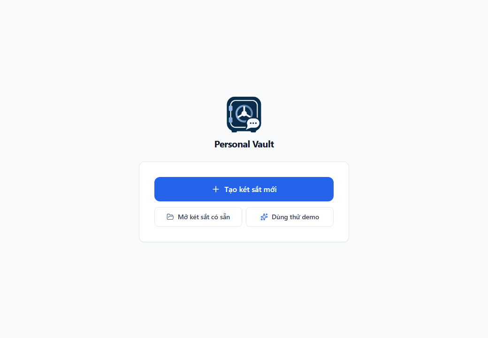
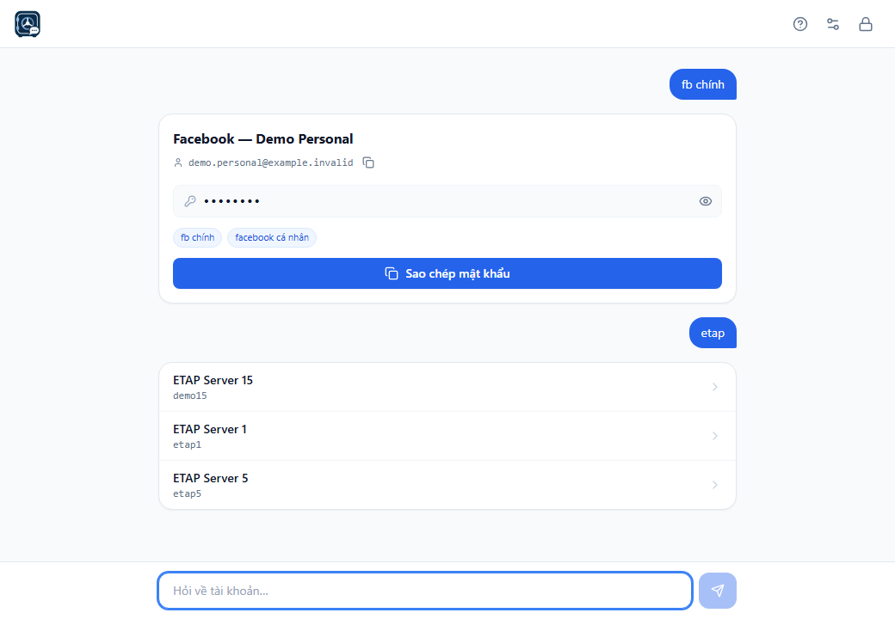
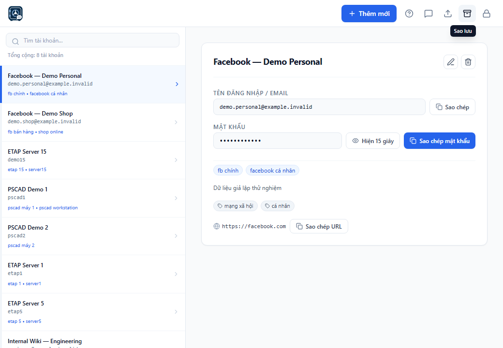
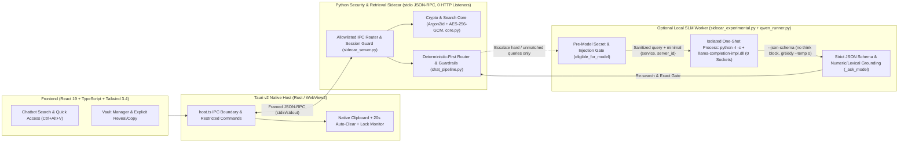

<p align="center">
  
</p>

<h1 align="center">Personal Vault — Local-First Encrypted Password Assistant</h1>

<p align="center">
  <strong>AI understands the query. The vault holds the truth. The backend enforces authorization. Only the user triggers reveal or copy.</strong>
</p>

<p align="center">
  <em>Sanitized Public Base Snapshot &mdash; Closure6 UI &bull; Hybrid Local AI Sidecar &bull; Locked Eval Suite &bull; ETW Net-Trace R4</em>
</p>

---

**Personal Vault** is a Windows desktop password manager built with a **Chatbot-first UX** (`React 19 + TypeScript + Tailwind` inside `Tauri v2`), a fail-closed Python cryptography sidecar (`Argon2id` + `AES-256-GCM`) communicating strictly over framed `stdin`/`stdout` JSON-RPC, and an optional **local CPU `Qwen3-0.6B-Q8_0` intent extractor** designed under a strict zero-trust secret boundary.

> **Repository scope & synthetic-data guarantee:** This public repository contains the sanitized base snapshot (`Closure6 UI + Hybrid AI Sidecar + Eval Suite + Net-Trace R4`) with synthetic fixtures only. No user vaults, model weights (`.gguf`), build binaries, or proprietary data exist in this tree.

---

## 1. Product Overview

Traditional password managers force users to remember exact titles or browse folders. Personal Vault makes natural search the primary interface while keeping sensitive credentials locked behind explicit user actions:

- **Chatbot-First Lookup & Disambiguation:** Ask in natural Vietnamese or English (with or without diacritics, aliases, server numbers, multi-turn follow-ups such as `"etap"` &rarr; `"máy 2"`, or exclusions like `"etap trừ 1, 5"`). Single confident matches show a masked account card; ambiguous queries render explicit manual choices instead of guessing.
- **Global Quick Access (`Ctrl+Alt+V`) & Split-Pane Vault Manager:** Instant keyboard-driven popup search alongside full CRUD, static UTF-8 import preview (CSV / JSON / txt / script comments without execution), and exclusive encrypted backups (`os.link`).
- **Offline Cryptography & Session Safety:** Vault files (`.pvault`) use `Argon2id` (`m=65536 KiB`, `t=3`, `p=1`, `32`-byte key) and `AES-256-GCM` with authenticated headers, atomic `fsync` writes, `15s` auto-hidden reveals, explicit copy confirmation dialogs, `20s` native clipboard auto-clear, and automatic fail-closed locking on idle, lock-screen (`Win+L`), suspend, or sidecar failure.
- **Isolated Demo Mode:** Built-in `500`-entry synthetic demo sandbox isolated from real vault files and sessions.

<p align="center">
  <table>
    <tr>
      <td align="center" width="50%">
        <br />
        <sub><strong>First-Run Lifecycle:</strong> Create vault, open existing vault, or launch isolated synthetic demo</sub>
      </td>
      <td align="center" width="50%">
        <br />
        <sub><strong>Chatbot Search:</strong> Exact masked card vs. manual disambiguation list</sub>
      </td>
    </tr>
    <tr>
      <td align="center" width="50%">
        <br />
        <sub><strong>Vault Manager:</strong> Chips for aliases/tags, 15s temporary reveal, copy-only URLs</sub>
      </td>
      <td align="center" width="50%">
        <br />
        <sub><strong>Secret Boundary:</strong> Explicit copy confirmation with 20s clear &amp; Win+V warning</sub>
      </td>
    </tr>
  </table>
</p>

---

## 2. System Architecture



---

## 3. AI Engineering Design Highlights

Most naive AI password assistants dump entries into a prompt or vector index, creating immediate exfiltration and hallucination risks. Personal Vault treats credentials as **unreadable to the LLM** and designs AI strictly as a constrained query-intent translator:

### A. Deterministic-First Hybrid Routing ([`sidecar/chat_pipeline.py`](sidecar/chat_pipeline.py))
- Exact titles, aliases, multi-turn ordinals (`"máy 2"`, `"cái thứ hai"`), and exclusions (`"pscad trừ 1, 5"`, `"không phải a mà b"`) resolve deterministically in **3.2–7.1 ms (p50)** without ever loading model weights.
- Escalation to [`QwenRunner`](sidecar/qwen_runner.py) triggers only when deterministic search returns `none`, or when a `suggestion`/`ambiguous` hit came from a complex conversational query (`>= 3` content tokens or `>= 6` tokens total).

### B. Zero-Trust Model Isolation & Zero-Socket Execution ([`sidecar/qwen_runner.py`](sidecar/qwen_runner.py))
- **Zero vault visibility:** The SLM never receives the vault database, `.pvault` path, master password, decrypted entries, usernames, descriptions, notes, or raw transcript history. Context is minimized strictly to `{service, server_id}` (validated in memory via `prompt_log`).
- **Socket-free `llama.cpp` execution:** Inspection with `netstat` (`evals/QWEN_REAL_INFERENCE_EVIDENCE.md`) showed that `llama-cli.exe` in `llama.cpp` build `11607` spins up an embedded `127.0.0.1` loopback HTTP server per call. To uphold zero listening sockets, [`QwenRunner`](sidecar/qwen_runner.py) defaults to the `completion` backend, invoking `llama-completion-impl.dll` directly via `python -I -c` with `stdin=subprocess.DEVNULL`, `CREATE_NO_WINDOW`, and a strict 7-variable environment allowlist (`_ENV_KEEP`). Process auditing with `psutil` confirmed **0 network sockets** during live inference.

### C. Pre-Model Secret Gate & Non-Thinking Structured Output
- **Input safety gate (`eligible_for_model`):** Before reaching the worker, inputs are stripped of invisible `Cf` Unicode format characters (prevents zero-width number splitting), capped at `200` chars, and checked against password-entropy heuristics (`secret_like`), key-value credential patterns, shell/script metacharacters, and prompt-injection signatures (`_INJECT`).
- **Pre-filled non-thinking decoding:** Qwen3 reasoning overhead is suppressed deterministically via a pre-filled `<|im_start|>assistant\n<think>\n\n</think>\n\n` turn combined with greedy decoding (`--temp 0`) and strict `--json-schema` grammar (`additionalProperties: false`, `intent` in `find_account | refine_search | clarify | unsupported`, `query <= 80`, `server_id: 0..9999`).

### D. Anti-Hallucination Grounding & Vietnamese Epistemic Retrieval ([`evals/PIPELINE_AUDIT.md`](evals/PIPELINE_AUDIT.md))
Even with schema constraints, small models (`0.6B`) exhibit failure modes in live inference — e.g., copying few-shot examples (`"tìm giúp tôi cái gì đó"` &rarr; `"gmail công ty"`) or bailing on valid technical strings (`"etap server 15"` &rarr; `unsupported`) ([`QWEN_REAL_INFERENCE_EVIDENCE.md`](evals/QWEN_REAL_INFERENCE_EVIDENCE.md)). To eliminate silent wrong answers:
- **Post-LLM Grounding (`_ask_model`):** Discards outputs containing words not grounded in the user's utterance (`SequenceMatcher >= 0.8` or valid ordinal normalization), and enforces **strict numeric identity invariance** (`user_nums` cannot be dropped, altered, or fabricated).
- **Exactness Invariants (`Exact Gate`):**
  - `_accent_conflict`: Prevents unaccented folding collisions (e.g., `"hộp"` vs `"họp"`, `"chính"` vs `"chỉnh"`).
  - `_protected_fillers`: Preserves stop-word lookalikes that are real content tokens (`"nhà"`, `"mô"`, standalone alphanumeric IDs like `"15a"` or `"Dev Box A"`).
  - `_risky_drop`: Any dropped word appearing in the vault vocabulary, capitalized mid-sentence, accented differently from pure function words, or single-character/numeric caps confidence from `exact` to `suggested` (user must confirm).
- **Fail-Safe Fallback:** Injecting runner crashes, timeouts (`10s`), `None`, and malformed JSON yields **138/138 identical deterministic fallback outputs**, **0 crashes**, and **0 secret leaks**.

---

## 4. Benchmarks, Locked Evals & Product Engineering Decisions

All benchmarks use **507 synthetic entries** (`500` generated demo accounts + test cases) on Windows 11 (`AMD Ryzen 7 8845HS`, 16 logical CPUs, Python `3.14.6`).

### Hybrid A/B Evaluation (`Qwen3-0.6B-Q8_0` CPU, 8 threads vs. Deterministic Baseline)
Measured on `138` queries (`86` dev / `52` held-out) in [`evals/results/qwen_eval_20261112_135035.json`](evals/results/qwen_eval_20261112_135035.json):

| Mode | Overall Correct (`n=138`) | Held-Out (`n=52`) | Acc@1 (`entry_n=75`) | AI Calls Fired | Median Answer Latency | Peak Worker RSS / Speed | Wrong When Exact (`false_exact`) | Secret Leaks |
|---|---:|---:|---:|---:|---:|---|---:|---:|
| **Deterministic-only** | `92.8%` | `96.2%` | `88.0%` | `0 / 138` | `7.1 ms` p50 (`19.9 ms` p95) | &mdash; | `0` | `0` |
| **Hybrid (Det + Qwen3-0.6B)** | **`97.8%`** | **`98.1%`** | **`97.3%`** | **`40 / 138`** (`98` det @ `3.2 ms` p50) | `11.3 ms` overall p50 (`1323 ms` p50 per AI call) | `918.8 MB` max / `68.9 tok/s` | **`0`** | **`0`** |

### Hardened Deterministic Suite & SHA-256 Locked Blind Held-Outs (Qwen OFF)
After replacing fragile stop-word patches with epistemic invariants in [`sidecar/chat_pipeline.py`](sidecar/chat_pipeline.py):

| Evaluation Suite | Fixture / Evidence | Sample Size | Correct | Safe Abstain / Clarify | Wrong Account | `false_exact` | Numeric Viol / Crashes |
|---|---|---:|---:|---:|---:|---:|---:|
| **Original Corpus** (`dev + held-out`) | [`search_eval_latest.md`](evals/results/search_eval_latest.md) | `138` | **`130`** (`94.2%`; `50/52` held-out `96.2%`) | `8` abstains (`0` clarify) | **`0`** | **`0`** | `0` num viol / `0` leaks |
| **Combined Search + Adversarial Red-Team R1–R7** | [`search_eval_latest.md`](evals/results/search_eval_latest.md) | `273` | `239` | `20` abstain + `1` clarify | `13` (multi-exclusion R6/R7) | **`0`** | `30` num viol / `0` leaks |
| **Blind Held-Out v2** (`SHA-256` locked) | [`heldout_v2_post_r7_fixes`](evals/results/heldout_v2_post_r7_fixes_20261114_065644.json) | `691` | `543` | `140` abstain + `6` clarify | `2` | **`0`** | `2` num viol / `0` crashes |
| **Blind Held-Out v3** (`SHA-256` locked) | [`heldout_v3_post_r7_fixes`](evals/results/heldout_v3_post_r7_fixes_20261114_065653.json) | `466` | `314` | `145` abstain + `3` clarify | `4` | **`0`** | `2` num viol / `0` crashes |

*(Wait-free `p95` across all `273` `search_eval.py` queries: **`22.2 ms`**; `heldout_eval.py` checks fixture `.sha256` locks before execution and refuses modified ground truth.)*

### Engineering Decision: Why Release Builds Default to `QWEN_ALLOWED = False`
As documented in [`sidecar/sidecar_server.py`](sidecar/sidecar_server.py) and [`evals/QWEN_REAL_INFERENCE_EVIDENCE.md`](evals/QWEN_REAL_INFERENCE_EVIDENCE.md):
1. Once deterministic invariants reached `94.2%` overall / `96.2%` held-out with `~22 ms p95` latency and `0` false exacts, most real-world queries no longer benefited from firing a `1.3 s` / `~919 MB` local model call.
2. In PyInstaller frozen builds (`getattr(sys, 'frozen', False)`), the DLL launcher falls back to `llama-cli.exe`, which opens loopback HTTP sockets on `127.0.0.1` — weakening the zero-socket boundary.
3. Shipping [`sidecar_server.py`](sidecar/sidecar_server.py) with `QWEN_ALLOWED = False` while keeping [`sidecar/sidecar_experimental.py`](sidecar/sidecar_experimental.py) (`PVAULT_QWEN=1`) for opt-in research reflects a deliberate **security-over-hype** trade-off.

---

## 5. Security & Network Verification Tooling

- [`tools/net_trace_host_scoped.ps1`](tools/net_trace_host_scoped.ps1) + [`web/e2e/net_trace_harness.ps1`](web/e2e/net_trace_harness.ps1): 5-window host-scoped ETW verification (`TCPIP`, `Kernel-Network`, optional `DNS-Client`) with privilege/ACL/reparse hardening (`Remove-OwnedRunDir`, signed System32 tool verification, `EventsLost` completeness gates).
- [`tools/control_webview2_host`](tools/control_webview2_host): Minimal independent Rust WebView2 control binary verifying whether traffic stems from app flags (`C1`) or WebView2 runtime defaults (`C2`).
- [`tools/net_trace_tests.ps1`](tools/net_trace_tests.ps1): Automated static & `-Dynamic` security regression suite (**50/50 PASS**).

---

## 6. Repository Structure

```text
PersonalVault_SPEC_v0.2.md        # Product, 8-layer AI, and security boundary specification
PersonalVault_MVP/                # Core crypto (.pvault Argon2id + AES-256-GCM), atomic persistence, Tkinter fallback & 48 core/security tests
sidecar/                          # Stdio JSON-RPC sidecar, hybrid ChatPipeline, isolated QwenRunner & 158 sidecar unit tests
evals/                            # A/B Qwen vs deterministic harness, SHA-256 locked blind held-out suites, 7 red-team rounds & results
web/                              # React 19 + TypeScript + Tailwind UI, Tauri v2 Rust host (src-tauri/), Playwright lifecycle/E2E suites
tools/                            # Host-scoped ETW trace engine, WebView2 Rust control host & 50-check test harness
qa-sandbox/                       # Windows Sandbox (.wsb + PowerShell) reproducible QA scripts
build_candidate.py                # Reproducible immutable build pipeline generating SHA256SUMS & provenance manifests
```

---

## 7. Quickstart & Reproducible Verification

### Python Core, Sidecar & AI Evals
```powershell
# 1. Core crypto, atomic storage, search & UI baseline (48 tests)
cd PersonalVault_MVP
python -m unittest discover -s tests

# 2. Sidecar JSON-RPC, ChatPipeline & QwenRunner safety tests (158 tests; skips 3 RealQwenTests unless PVAULT_MODEL_PATH & PVAULT_LLAMA_DIR are set)
cd ..\sidecar
python -m unittest discover -s tests

# 3. Run deterministic search + R1-R7 red-team evaluation (no model weights required)
cd ..
python evals\search_eval.py

# 4. Run SHA-256 locked blind held-out evaluations
python evals\heldout_eval.py --fixture evals\fixtures\heldout_blind_v2.json
python evals\heldout_eval.py --fixture evals\fixtures\heldout_blind_v3.json

# 5. Optional: run A/B hybrid evaluation against local Qwen3-0.6B GGUF + llama.cpp
$env:PVAULT_MODEL_PATH = "<PATH_TO>\Qwen3-0.6B-Q8_0.gguf"
$env:PVAULT_LLAMA_DIR  = "<PATH_TO_LLAMA_CPP_DIR>"
python evals\qwen_eval.py          # omit env vars and pass --skip-qwen for deterministic-only benchmark
```

### Frontend, Playwright UI Contracts & ETW Harness Tests
```powershell
# 6. Install root Playwright devDependency and web dependencies
npm install
cd web
npm install

# 7. Lint, TypeScript build & 26 Playwright mock-bridge regression tests
npm run lint
npm run build
node --test tests\first_launch.test.mjs

# 8. Net-Trace R4 static & dynamic verification (50 checks, non-elevated dry-run)
cd ..
powershell.exe -NoProfile -ExecutionPolicy Bypass -File tools\net_trace_tests.ps1 -Script tools\net_trace_host_scoped.ps1 -Harness web\e2e\net_trace_harness.ps1 -Dynamic
```
